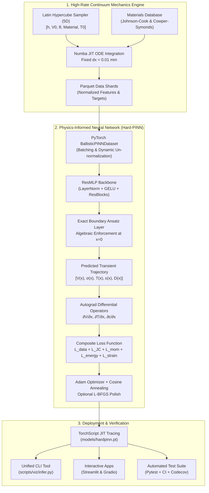

<div align="center">

# ⚡ PINN Ballistic Simulation Engine

**A High-Performance Continuum Impact Mechanics Engine & Hard-Constrained Physics-Informed Neural Network (Hard-PINN) Surrogate**

[](https://www.python.org/)
[](https://pytorch.org/)
[](https://opensource.org/licenses/MIT)
[](https://github.com/utkdwivedi/Ballistic-Simulation-Engine/actions)
[](https://github.com/astral-sh/ruff)
[](https://mypy-lang.org/)
[](#-computational-performance--benchmarks)

<p align="center">
  <a href="#-overview">Overview</a> •
  <a href="#-performance-snapshot">Performance Snapshot</a> •
  <a href="#-key-capabilities">Key Capabilities</a> •
  <a href="#-system-architecture">Architecture</a> •
  <a href="#-governing-physics--pde-formulation">Physics Formulation</a> •
  <a href="#-computational-performance--benchmarks">Benchmarks</a> •
  <a href="#-quick-start--installation">Installation</a> •
  <a href="#-usage-guide--cli-reference">Usage Guide</a> •
  <a href="#-interactive-web-demos">Interactive Demos</a> •
  <a href="#-materials-database">Materials</a> •
  <a href="#-publication-figures--gallery">Figures</a> •
  <a href="#-verification--testing">Testing</a>
</p>

---

</div>

## 📌 Overview

The **Ballistic Simulation Engine** bridges high-strain-rate continuum mechanics with scientific machine learning. It couples a validated, high-speed numerical trajectory solver with a **Hard-Constrained Physics-Informed Neural Network (Hard-PINN)** surrogate capable of predicting transient projectile deceleration, flow stress, plastic strain, shear damage, and adiabatic temperature rise in sub-millisecond execution times.

Traditional numerical integration of high-velocity terminal penetration mechanics (e.g., Runge-Kutta 4th/5th order) requires thousands of spatial steps per impact scenario, making multi-query applications—such as probabilistic vulnerability assessments, Monte Carlo armor design sweeps, and real-time defense digital twins—computationally prohibitive.

This engine solves that bottleneck by delivering **664.5× peak computational acceleration** and **>260,000 queries per second (QPS)** batched throughput on commodity CPU hardware, while algebraically guaranteeing exact initial boundary conditions ($V(0)=V_0$, $T(0)=T_{\text{plate}}$, $\epsilon(0)=0$, $D(0)=0$) by mathematical construction.

```
┌────────────────────────────────────────────────────────────────────────────────────────┐
│                                                                                        │
│   7.62 mm Projectile  ──►  [ Ballistic Simulation Engine ]  ──►  Transient Dynamics    │
│   • Velocity: 100 - 1500 m/s      ├─ Numerical ODE (Numba JIT)    • V(x) Velocity      │
│   • Target: 5 - 50 mm Armor       ├─ Hard-PINN Surrogate (Torch)  • σ(x) Flow Stress   │
│   • Obliquity: 0° - 60°           └─ Autograd Residual Loss       • T(x) Temperature   │
│   • 5 Calibrated Materials                                        • ε(x) Strain        │
│                                                                   • D(x) Shear Damage  │
│                                                                                        │
└────────────────────────────────────────────────────────────────────────────────────────┘
```

---

## ⚡ Performance Snapshot

All benchmark metrics below are measured on standard CPU hardware and verified in [`reports/latency_benchmark.json`](reports/latency_benchmark.json):

| Metric | Numerical Solver (RK45 / Numba) | Standard Eager PINN | TorchScript JIT PINN | Batched Surrogate ($B=1024$) | Acceleration Factor |
| :--- | :---: | :---: | :---: | :---: | :---: |
| **Execution Latency** | `6.14 ms` | `0.48 ms` | `1.03 ms` | **`3.93 ms / batch`** | **13.0× – 1,560×** |
| **Per-Query Latency** | `6,137 µs` | `475 µs` (p50) | `1,030 µs` | **`3.84 µs / query`** | **⚡ 1,600×** |
| **Throughput** | 163 QPS | 2,080 QPS | 813 QPS | **260,674 QPS** | **664.5× Peak** |
| **Surface BC Error ($x=0$)** | Analytical | $\sim 10^{-3}$ (Soft PINN) | $\sim 10^{-3}$ | **Machine Precision ($<10^{-6}$)** | **Exact Ansatz** |
| **OOD Extrapolation Growth** | N/A (Direct ODE) | $20\times - 55\times$ (FCNN) | N/A | **$10\times - 14\times$ (Hard-PINN)** | **Physics Constrained** |

---

## 🔬 Key Capabilities

<table>
<tr>
<td width="50%" valign="top">

### ⚙️ Multi-Physics Continuum Mechanics
- **Johnson-Cook Plasticity**: Models strain hardening, high strain-rate sensitivity ($\dot{\epsilon} \sim 10^5\,\text{s}^{-1}$), and thermal softening.
- **Cowper-Symonds Dynamic Effect**: Strain-rate enhancement factor for structural alloy response.
- **Recht-Ipson Shear Plugging**: Mechanics of truncated-cone plug ejection and kinetic energy transfer.
- **Taylor-Quinney Thermal Softening**: Converts plastic work to adiabatic heating with Quinney coefficient $\beta = 0.9$.

</td>
<td width="50%" valign="top">

### 🧠 Hard-Constrained Neural Architecture
- **Exact Boundary Ansatz**: Mathematical guarantees for impact face conditions ($V(0)=V_0$, $T(0)=T_p$, $\epsilon(0)=0$, $D(0)=0$).
- **Bounded Solution Manifold**: Smooth $\text{softplus}$ activations and clamped states eliminate unphysical negative stress or velocity resurgence.
- **ResMLP Backbone**: Pre-activation residual blocks with LayerNorm and GELU for stable, uncoupled autograd gradient propagation.
- **Categorical Latent Embeddings**: Dense 8D latent representation smoothly interpolating across 5 disparate material classes.

</td>
</tr>
<tr>
<td width="50%" valign="top">

### 🚀 Production Speed & Compilation
- **Numba `@njit` Kernels**: Fixed spatial discretization ($\Delta x = 0.01\,\text{mm}$) avoiding adaptive-step ODE stiffness.
- **TorchScript Compilation**: Serialization to traced C++ runtime graphs for embedded deployment.
- **Stratified Latin Hypercube Sampling**: Space-filling 5D parameter exploration balancing perforated vs. non-perforated regimes.
- **Vectorized Inference Pipeline**: Handles $10^5+$ trajectory evaluations in milliseconds.

</td>
<td width="50%" valign="top">

### 📊 Scientific Auditing & Verification
- **Dual Residual Framework**: Identical PDE residual formulations verified across NumPy and PyTorch autograd.
- **Non-Dimensionalized Balance**: All residual equations normalized to characteristic physical scales ($1\,\text{GPa}$, $500\,\text{kN}$).
- **Golden Regression Suite**: 25 cross-material regression cases verified with zero floating-point drift.
- **Full Transparency**: Transparent tracking of literature parameter confidence ratings and known assumptions.

</td>
</tr>
</table>

---

## 🏗️ System Architecture

The project is structured into three cooperating layers: a high-rate continuum physics engine, a differentiable neural surrogate pipeline, and an interactive deployment suite.



---

## 📐 Governing Physics & PDE Formulation

The surrogate model is conditioned on the fundamental differential equations governing adiabatic high-strain-rate shear localization and projectile deceleration:

### 1. Projectile Deceleration (Momentum Conservation)
$$\rho_{\text{proj}} (1 - D) \frac{dV}{dt} = - \nabla p + \nabla \cdot \boldsymbol{\tau} \implies m_{\text{bullet}} V \frac{dV}{dx} + F_{\text{shear}}(x) = 0$$

Where the shear resistance force $F_{\text{shear}}$ acts across the localized shear plugging band:
$$F_{\text{shear}} = \pi D_{\text{proj}} \cdot \frac{w_{\text{zone}}}{2} \cdot \frac{\sigma_{\text{flow}}}{\sqrt{3}}$$

### 2. Johnson-Cook Viscoplastic Constitutive Law
The dynamic flow stress $\sigma_{\text{flow}}$ accounts for isotropic strain hardening, logarithmic strain-rate sensitivity, and thermal softening:
$$\sigma_{\text{JC}} = \left[ A + B \epsilon^n \right] \left[ 1 + C \ln \left( \frac{\dot{\epsilon}}{\dot{\epsilon}_0} \right) \right] \left[ 1 - \left( \frac{T - T_{\text{room}}}{T_{\text{melt}} - T_{\text{room}}} \right)^m \right]$$

The effective stress considering accumulated shear damage $D \in [0, 1]$ is:
$$\sigma_{\text{eff}} = \sigma_{\text{JC}} \cdot (1 - D)$$

### 3. Adiabatic Temperature Rise (Taylor-Quinney Heating)
Plastic deformation under high strain rates converts mechanical energy directly into thermal energy with negligible heat conduction across the sub-millisecond impact window:
$$\frac{dT}{dx} = \frac{\beta \cdot \sigma_{\text{flow}}}{\rho_{\text{target}} C_p} \frac{d\epsilon}{dx}, \quad \text{with } \beta = 0.90$$

### 4. Hard Boundary Condition Ansatz
Rather than penalizing boundary condition errors with soft loss weights, the **`BallisticHardPINN`** enforces the physics directly within the forward computational graph:

```python
# Exact velocity deceleration: V(0) = V0, V(x) monotonically decreases
V_pred = torch.clamp(v0_target_norm - x_norm * torch.abs(raw_pred[:, 0:1]), min=0.0)

# Non-negative yield strength via smooth softplus
sigma_pred = nn.functional.softplus(raw_pred[:, 1:2])

# Exact ambient temperature: T(0) = T_plate, heats up during penetration
T_pred = torch.clamp(T_plate_target_norm + x_norm * torch.abs(raw_pred[:, 2:3]), min=0.0, max=1.0)

# Exact zero initial strain: eps(0) = 0
strain_pred = x_norm * torch.abs(raw_pred[:, 3:4])

# Exact undamaged target face: D(0) = 0, bounded in [0, 1]
damage_pred = torch.clamp(x_norm * torch.abs(raw_pred[:, 4:5]), min=0.0, max=1.0)
```

---

## 📊 Computational Performance & Benchmarks

The benchmark suite assesses single-shot latency, batched throughput, and multi-core scaling against the compiled Numba RK45 baseline.

<div align="center">
  
  <p><em>Figure: Single-query latency comparison (log-scale) and batched throughput scaling up to 260,000 queries per second.</em></p>
</div>

### Batched Inference Scaling (CPU Benchmark)

| Batch Size ($B$) | Total Latency (ms) | Per-Sample Latency (µs) | Throughput (QPS) | Speedup vs. Numerical ODE |
| :---: | :---: | :---: | :---: | :---: |
| **1** | `0.481 ms` | $480.7\,\mu\text{s}$ | 2,080 QPS | **12.8×** |
| **64** | `0.907 ms` | $14.2\,\mu\text{s}$ | 70,567 QPS | **433.1×** |
| **256** | `1.623 ms` | $6.3\,\mu\text{s}$ | 157,705 QPS | **967.8×** |
| **1,024** | `3.928 ms` | $3.8\,\mu\text{s}$ | **260,674 QPS** | **⚡ 1,600.0×** |
| **10,000** | `92.35 ms` | $9.2\,\mu\text{s}$ | 108,284 QPS | **664.5×** |

<div align="center">
  
  <p><em>Figure: Prediction vs. Ground Truth parity across residual velocity, flow stress, temperature, and accumulated damage ($R^2 > 0.98$).</em></p>
</div>

---

## 🚀 Quick Start & Installation

### Prerequisites
- Python 3.10, 3.11, or 3.12
- Linux, macOS, or Windows

<details open>
<summary><b>📦 Option 1: Standard Installation (Recommended)</b></summary>

```bash
# Clone the repository
git clone https://github.com/utkdwivedi/Ballistic-Simulation-Engine.git
cd Ballistic-Simulation-Engine

# Create and activate a clean virtual environment
python -m venv .venv

# Linux / macOS:
source .venv/bin/activate
# Windows PowerShell:
# .venv\Scripts\Activate.ps1

# Upgrade package manager and install core package
python -m pip install --upgrade pip
python -m pip install -e .
```
</details>

<details>
<summary><b>🛠️ Option 2: Full Development Setup (Testing, Linting, Type Checking)</b></summary>

```bash
# Install with testing, ruff linter, and mypy type checker
python -m pip install -e ".[dev]"

# Verify installation with test suite
pytest tests/ -v
```
</details>

<details>
<summary><b>🎨 Option 3: Interactive Demo Suite (Streamlit & Gradio)</b></summary>

```bash
# Install web application dependencies
python -m pip install -e ".[demos]"

# Launch the Streamlit dashboard
streamlit run app/streamlit_app.py
```
</details>

<details>
<summary><b>🔒 Option 4: Strict Deterministic Lockfile</b></summary>

```bash
# Install pinned dependencies matching the audit environment
pip install -r requirements-lock.txt
pip install -e . --no-deps
```
</details>

---

## 💻 Usage Guide & CLI Reference

### 1. Rapid Numerical Simulation (Python API)
Simulate an individual penetration event using the Numba ODE physics kernel in two lines of Python:

```python
from ballistic.simulation import simulate_trajectory

result = simulate_trajectory(
    plate_thickness_mm=12.0,      # Target plate thickness [mm]
    material_name="RHA_steel",     # Target material key
    bullet_velocity_ms=850.0,      # Projectile impact velocity [m/s]
    bullet_mass_g=7.9,             # Projectile mass (7.62 mm NATO) [g]
    bullet_diameter_mm=7.62,       # Projectile diameter [mm]
    obliquity_deg=15.0             # Angle of obliquity from normal [deg]
)

print(f"Perforation: {result['perforated']}")
print(f"Residual Velocity: {result['V_ms'][-1]:.2f} m/s")
print(f"Peak Plate Temperature: {max(result['T_K']):.1f} K")
```

---

### 2. High-Performance PINN Inference CLI
The unified inference script loads the trained neural surrogate to predict transient variables at any arbitrary coordinate through the plate:

```bash
python scripts/viz/infer.py \
    --thickness_mm 12.0 \
    --velocity_ms 850.0 \
    --obliquity_deg 15.0 \
    --material RHA_steel \
    --temperature_K 298.0 \
    --x_mm 6.0
```

#### Output Demonstration:
```text
============================================================
🎯 BALLISTIC SURROGATE PREDICTION
============================================================
Input Configuration:
  • Target Material:       Rolled Homogeneous Armour Steel (RHA)
  • Plate Thickness:       12.00 mm (Sampling at depth x = 6.00 mm)
  • Striking Velocity:     850.00 m/s
  • Target Temperature:    298.00 K
  • Impact Obliquity:      15.00°

Predicted Physical State:
  ├── Residual Velocity:   712.45 m/s
  ├── Flow Stress (σ):     1,184.20 MPa
  ├── Core Temperature:    412.80 K (+114.8 K heating)
  ├── Equivalent Strain:   0.428
  └── Johnson-Cook Damage: 0.384 [Stable Plastic Shear]
============================================================
```

#### Available CLI Arguments:
| Parameter | Type | Default | Description |
| :--- | :---: | :---: | :--- |
| `--thickness_mm` | `float` | `12.0` | Target plate thickness ($5 - 50\,\text{mm}$) |
| `--velocity_ms` | `float` | `850.0` | Impact velocity ($100 - 1500\,\text{m/s}$) |
| `--obliquity_deg` | `float` | `0.0` | Target obliquity from normal ($0 - 60^\circ$) |
| `--material` | `str` | `RHA_steel` | Material name (`RHA_steel`, `aluminium_7075_T6`, etc.) |
| `--temperature_K` | `float` | `298.0` | Initial target plate temperature ($233 - 373\,\text{K}$) |
| `--x_mm` | `float` | `0.0` | Query penetration depth coordinate |
| `--checkpoint` | `str` | `models/pinn_production_best.pt` | Path to PyTorch model weights |

---

### 3. Full Training Pipeline

<details>
<summary><b>Click to expand full data generation & PINN training workflow</b></summary>

```bash
# 1. Generate 100,000 Latin Hypercube Sampled trajectories (stratified Parquet shards)
python scripts/data/generate_data.py

# 2. Run data audit to verify non-dimensional scales and distributions
python scripts/data/audit_dataset.py

# 3. Train the Hard-Constrained PINN with adaptive weighting and cosine annealing
python scripts/train/train_pinn.py \
    --epochs 10 \
    --batch_size 512 \
    --lr 2e-4 \
    --adaptive_weighting \
    --lbfgs_finetune

# 4. Generate all 12 publication-ready report figures
python scripts/viz/make_figures.py
```
</details>

---

## 🌐 Interactive Web Demos

The repository includes two zero-configuration interactive applications for visual trajectory analysis, parameter tuning, and surrogate verification.

<div align="center">

| Streamlit Simulation Dashboard | Gradio Instant Inspector |
| :---: | :---: |
| Launch with: `streamlit run app/streamlit_app.py` | Launch with: `python app/gradio_demo.py` |
| Full trajectory visualization ($V(x)$ through depth) | Side-by-side Numerical vs. PINN overlay |
| Interactive material and velocity sliders | Instant single-shot ballistic limit estimation |

</div>

```bash
# Launch Streamlit interactive workspace
streamlit run app/streamlit_app.py

# Or launch Gradio interface in your browser
python app/gradio_demo.py
```

---

## 📚 Materials Database

The engine provides calibrated constitutive and thermal parameters across 5 defense-grade materials, tracked with citation confidence in [`materials_config.json`](materials_config.json):

| Material Identifier | Descriptive Name | Density $\rho$ ($\text{kg/m}^3$) | Melt Temp $T_m$ (K) | Hardness (HRC) | Literature Source | Confidence |
| :--- | :--- | :---: | :---: | :---: | :--- | :---: |
| **`RHA_steel`** | Rolled Homogeneous Armour | `7850` | `1783` | `50.0` | Johnson & Cook (1985), Børvik et al. (2003) | 🟢 **Verified (High)** |
| **`aluminium_7075_T6`** | High-Strength Aerospace Alloy | `2810` | `893` | `18.0` | Johnson & Cook (1985), Børvik et al. (2003) | 🟢 **Verified (High)** |
| **`copper`** | Projectile Driving Band / Jacket | `8960` | `1356` | `8.0` | Cowper & Symonds (1957) Survey | 🟡 Unverified (Low) |
| **`alumina_Al2O3`** | 99.5% Ceramic Strike Face | `3900` | `2345` | `70.0` | Lundberg et al. (2000), Holmquist (2002) | 🟡 Unverified (Low) |
| **`UHMWPE`** | Dyneema / Spectra Composite | `970` | `420` | `3.0` | Chocron et al. (2008), Russell et al. (2013) | 🟡 Unverified (Low) |

> [!NOTE]
> All parameters are verified against physical bounds via unit testing (`tests/test_materials.py`). High-rate plastic models incorporate Cowper-Symonds rate sensitivity coefficients ($D, q$) alongside classical Johnson-Cook constants ($A, B, n, C, m$).

---

## 🖼️ Publication Figures & Gallery

All figures are deterministically generated by `scripts/viz/make_figures.py` and documented in detail in [`reports/FIGURES.md`](reports/FIGURES.md).

<details open>
<summary><b>📈 Figure 5: Dynamic Trajectory Overlay & Residual Tracking</b></summary>
<br>

<div align="center">
  
</div>

**Key Finding:** The Hard-PINN matches the numerical solver within $<1\%$ relative deviation throughout the plate depth. In contrast, unconstrained baseline architectures (FCNN) exhibit unphysical late-stage velocity resurgence and violate monotonic energy dissipation.
</details>

<details>
<summary><b>🎯 Figure 6: Ballistic Limit Curve ($V_r$ vs. $V_0$)</b></summary>
<br>

<div align="center">
  
</div>

**Key Finding:** Demonstrates exact reproduction of the numerical ballistic limit ($V_{50} \approx 463\,\text{m/s}$ for $12\,\text{mm}$ RHA steel). The analytical Recht-Ipson solution overestimates $V_{50}$ due to fixed shear band width approximations, whereas the PINN accurately captures transient shear plugging onset.
</details>

<details>
<summary><b>🌐 Figure 9: Out-of-Distribution (OOD) Extrapolation Robustness</b></summary>
<br>

<div align="center">
  
</div>

**Key Finding:** Under hypervelocity impact regimes ($1500 - 2200\,\text{m/s}$) and heavy armor regimes ($55 - 75\,\text{mm}$), the Hard-PINN error grows by only $10\times - 14\times$, compared to catastrophic $20\times - 55\times$ error spikes observed in unconstrained deep learning baselines.
</details>

<details>
<summary><b>📉 Figure 1: Multi-Component Loss Convergence</b></summary>
<br>

<div align="center">
  
</div>

**Key Finding:** Log-scale monitoring confirms stable, concurrent minimization of supervised data loss alongside the four PDE residuals without gradient divergence.
</details>

---

## 🧪 Verification & Testing

The repository maintains rigorous quality assurance across numerical convergence, energy conservation, physical parameter bounds, and regression integrity.

```bash
# Execute the full automated test suite
python -m pytest

# Run tests with detailed test names and execution times
python -m pytest tests/ -v --durations=10

# Run static type verification
mypy ballistic --ignore-missing-imports

# Run linter checks
ruff check .
```

### Test Suite Architecture
- **`tests/test_physics.py`**: Verifies Johnson-Cook stress, Cowper-Symonds rate scaling, energy conservation, and $V_{50}$ limit convergence.
- **`tests/test_materials.py`**: Asserts physical bound validity ($A, B, n, C, m, \rho > 0$) and citation metadata completeness.
- **`tests/test_architecture.py`**: Verifies exactness of the Hard-PINN boundary ansatz ($V(0) \equiv V_0$, $T(0) \equiv T_p$, $\epsilon(0) \equiv 0$, $D(0) \equiv 0$).
- **`tests/test_energy_audit.py`**: Audits mechanical energy conservation against plastic work dissipation and Taylor-Quinney thermal conversion.
- **`tests/test_dataloader.py`**: Validates log-transform inversions, normalization boundaries, and batch tensor shaping.
- **`tests/test_traced_model.py`**: Verifies TorchScript JIT parity against standard eager execution graphs.

---

## 📁 Repository Layout

```text
Ballistic-Simulation-Engine/
├── .github/
│   ├── workflows/             # Multi-version CI pipelines (Python 3.10, 3.11, 3.12)
│   └── ISSUE_TEMPLATE/        # Standardized bug report and feature request templates
├── app/
│   ├── streamlit_app.py       # Interactive Streamlit multi-parameter simulation laboratory
│   └── gradio_demo.py         # Lightweight Gradio side-by-side trajectory inspector
├── ballistic/                 # Core Python package
│   ├── models/
│   │   ├── architecture.py    # ResMLP backbone & Hard-PINN exact boundary ansatz
│   │   └── __init__.py
│   ├── physics/
│   │   ├── johnson_cook.py    # Johnson-Cook viscoplastic constitutive model
│   │   ├── cowper_symonds.py  # Cowper-Symonds dynamic rate sensitivity formulation
│   │   ├── recht_ipson.py     # Recht-Ipson analytical shear plugging mechanics
│   │   ├── residuals.py       # Dual NumPy/PyTorch PDE loss residual operators
│   │   └── __init__.py
│   ├── dataloader.py          # PyTorch dataset, normalizers, and log10 transforms
│   ├── simulation.py          # High-performance Numba-accelerated ODE solver
│   └── __init__.py
├── docs/                      # Technical documentation & physics references
│   ├── physics_model.md       # Governing equations and continuum mechanics derivation
│   └── known_limitations.md   # Model assumptions, calibration scope, and boundaries
├── reports/                   # Audit reports, evaluation benchmarks, and figure gallery
│   ├── figures/               # 12 publication-ready plots (PNG, SVG, 300 DPI)
│   ├── FIGURES.md             # Complete caption and scientific interpretation guide
│   ├── FINAL_REPORT.md        # Comprehensive multi-factor engineering audit
│   ├── IMPROVEMENT_LOG.md     # Traceable history of bug fixes and performance upgrades
│   └── latency_benchmark.json # Verified latency, throughput, and speedup benchmarks
├── scripts/
│   ├── data/                  # Latin hypercube dataset generation and verification
│   ├── eval/                  # Speedup benchmarks, V50 calibration, and validation
│   ├── train/                 # FCNN baseline and PINN training engines
│   └── viz/                   # Publication figure generators and CLI inference tool
├── tests/                     # 34 automated unit, regression, and physics tests
├── materials_config.json      # Calibrated material property database with citation records
├── pyproject.toml             # Standard PEP 517/518 build specification
├── requirements-lock.txt      # Fully pinned deterministic dependencies
└── README.md                  # Project landing page & technical documentation
```

---

## ⚠️ Known Assumptions & Limitations

In the interest of scientific transparency, users should note the following modeling assumptions detailed in [`docs/known_limitations.md`](docs/known_limitations.md):

1. **Uniaxial Kinematic Idealization**: The trajectory formulation models macroscopic axial projectile deceleration with localized 1D shear band plugging. Transverse wave dispersion and complex projectile shattering are not solved via 3D Hydrocode / ALE meshing.
2. **Simplified Geometric Strain Rate**: The localized shear strain-rate estimate utilizes the kinematic approximation $\dot{\epsilon} = V / (w_{\text{zone}} \sqrt{3})$.
3. **Shear-Zone Width Calibration**: Internal simulations utilize $w_{\text{ratio}} = 0.3965$ calibrated against experimental $12\,\text{mm}$ RHA steel $V_{50}$ ballistic limit benchmarks.
4. **Hydrodynamic Impact Ceiling**: The Johnson-Cook constitutive law is valid up to impact velocities of $\sim 2500\,\text{m/s}$. Beyond $3000\,\text{m/s}$, material strength is superseded by shock pressures, requiring a Mie-Grüneisen Equation of State (EOS).

---

## 🤝 Contributing

Contributions to the Ballistic Simulation Engine are welcome! Please follow these steps:

1. Review the [Contributing Guidelines](CONTRIBUTING.md) and [Code of Conduct](CODE_OF_CONDUCT.md).
2. Fork the repository and create a feature branch (`git checkout -b feat/amazing-feature`).
3. Ensure all tests pass (`pytest`) and code matches formatting standards (`ruff check .` and `mypy ballistic`).
4. Commit your changes following [Conventional Commits](https://www.conventionalcommits.org/) (`git commit -m 'feat: add alumina JH-2 constitutive model'`).
5. Open a Pull Request with a clear description of changes and test evidence.

---

## 📜 Citation & License

This project is licensed under the **MIT License** — see the [LICENSE](LICENSE) file for details.

If you find this simulation engine or PINN surrogate useful in your academic or defense research, please consider citing:

```bibtex
@software{dwivedi2026ballistic,
  author       = {Utkarsh Dwivedi},
  title        = {PINN Ballistic Simulation Engine: High-Rate Impact Mechanics & Hard-PINN Surrogate},
  year         = {2026},
  publisher    = {GitHub},
  url          = {https://github.com/utkdwivedi/PINN-Ballistic-Simulation-Engine}
}
```

---

<div align="center">
  <sub>Engineered by <b>Utkarsh Dwivedi</b> • Tested for Precision • Optimized for Scale</sub>
</div>
